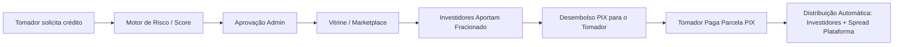

# 📋 Dossiê Executivo & Guia Técnico para Alinhamento com o Cliente
## Integração de Gateway de Pagamento (Asaas) & Status Completo do Sistema P2P (MVP V1)

---

## 🎯 Objetivo Deste Documento
Este documento foi elaborado para conduzir com total segurança e clareza a reunião com o cliente. Ele contém:
1. **O status e funcionamento detalhado de cada módulo do sistema** (para você apresentar e tirar qualquer dúvida de negócio).
2. **O roteiro passo a passo da integração com o Asaas** (o que solicitar, onde clicar, onde colar as chaves e como testar na hora).
3. **FAQ estratégico** para responder às principais perguntas financeiras e de segurança que o cliente possa fazer.

---

## 1. 🏗️ Visão Geral & Maturidade do Sistema (MVP V1)

O **Sistema P2P** é uma plataforma financeira multilateral que conecta **Tomadores de Crédito** (pessoas físicas ou jurídicas que necessitam de empréstimo) a **Investidores** (que aportam capital em busca de rentabilidade superior ao mercado tradicional), utilizando um modelo de **Partidas Dobradas (Livro-Razão / Ledger)** com proteção contra falhas e concorrência.

### Estado Atual do Sistema:
- **Backend (.NET 8 / C#):** 100% funcional, fortemente tipado, com **47 testes automatizados** cobrindo todas as regras financeiras, amortizações e integridade contábil.
- **Frontend (Angular 19):** Interface moderna e responsiva com componentes dedicados para o Tomador, Investidor e Backoffice do Administrador.
- **Ambiente de Gateway Pré-Configurado:** Módulos de comunicação com a API v3 do Asaas, geração de PIX dinâmico, verificação de conectividade e receptores de Webhooks já implementados no código.

---

## 2. 🧩 Catálogo Completo de Funcionalidades do Sistema

Apresente ao cliente como o sistema opera de ponta a ponta:



### 2.1. Onboarding, Cadastro e Motor de Risco (Score de Crédito)
- **Questionário Socioeconômico:** O tomador responde a perguntas sobre renda, histórico profissional e restrições financeiras.
- **Algoritmo de Rating Automático:** O sistema calcula a pontuação do usuário e o enquadra em uma classificação de risco:
  - **Score A (Excelente):** Libera limites altos com as menores taxas de juros da plataforma.
  - **Score B (Moderado):** Limites intermediários e taxas padrão.
  - **Score C (Arrojado):** Limites restritos e taxas de juros mais elevadas (compensação de risco).
  - **Score D (Crítico):** Bloqueio automático para proteger o capital dos investidores.
- **Parametrização Dinâmica (Admin):** O Administrador pode alterar os limites de crédito e taxas de cada faixa diretamente no painel, sem mexer em código.

---

### 2.2. A Esteira do Tomador de Crédito (Borrower Flow)
- **Simulação e Solicitação:** O tomador escolhe o valor e o número de parcelas (calculadas pelo sistema de amortização Price/SAC). O valor máximo é travado contra o Score aprovado.
- **Contrato e Parcelamento:** Uma vez aprovada a solicitação pelo administrador, o contrato digital é gerado e as parcelas contábeis são registradas no banco de dados.
- **Cálculo Automático de Mora:** Caso uma parcela fique em atraso, o sistema calcula automaticamente a multa contratual (ex: 2%) e os juros de mora diários proporcionais aos dias de atraso.

---

### 2.3. A Vitrine de Investimentos e Captação Fracionada (Funding)
- **Prateleira de Produtos:** Investidores visualizam oportunidades categorizadas por nível de risco (Conservador, Moderado, Arrojado) com taxas de rentabilidade projetadas.
- **Investimento Fracionado:** Múltiplos investidores podem financiar um mesmo empréstimo (ex: um empréstimo de R$ 10.000 pode receber R$ 1.000 de um investidor, R$ 4.000 de outro e R$ 5.000 de um terceiro).
- **Segurança de Saldo (Disponível vs Comprometido vs Investido):**
  - Ao investir, o capital do investidor vai para **Saldo Comprometido** (fica reservado até a captação atingir 100%).
  - Se a captação for concluída, o saldo vira **Saldo Investido**.
  - Se a operação for cancelada, o valor retorna limpo e seguro para o **Saldo Disponível**.

---

### 2.4. Motor de Split de Pagamento e Spread da Plataforma
- **Repasse Proporcional:** No momento em que o tomador paga uma parcela via PIX, o sistema fatiará o valor pago instantaneamente e creditará a cada investidor a sua fatia exata de principal + juros.
- **Retenção de Lucro (Spread):** A diferença entre os juros cobrados do tomador e os juros prometidos ao investidor é creditada automaticamente na conta contábil de **Receita da Plataforma (`PlatformRevenue`)**.
- **Consistência Decimal:** Algoritmos matemáticos anti-dízima garantem que nenhum centavo se perca em arredondamentos.

---

### 2.5. Livro-Razão Contábil (Ledger) e Tesouraria
- **Partidas Dobradas:** Nenhuma movimentação financeira ocorre de forma isolada. Cada débito possui um crédito correspondente entre contas contábeis (`ExternalGateway` -> `PlatformCash` -> `InvestorWallet`).
- **Fechamento de Caixa (Snapshots):** O administrador pode registrar e acompanhar o balanço patrimonial e a liquidez total da plataforma com gráficos históricos.
- **Prevenção Anti-Fraude e Anti-Concorrência:** Travas atômicas e tokens de idempotência impedem saques duplicados ou requisições simultâneas maliciosas.

---

### 2.6. Backoffice Administrativo e Relatórios Executivos
- **Gestão de Usuários:** Aprovação, reprovação e consulta de documentos e perfis de tomadores e investidores.
- **Central de Inadimplência:** Régua de cobrança visual, lista de contratos em atraso e ações de recuperação.
- **Relatórios Gerenciais em PDF:** Geração de relatórios com balanços consolidados, taxas médias, volume de transações e projeções de receita.

---

## 3. 💳 A Integração com o Gateway de Pagamento (Asaas)

### Por que o Asaas?
1. **PIX Dinâmico Instantâneo:** Gera QR Code e Copia-e-Cola com valor e vencimento definidos, permitindo conciliação automática via Webhook em menos de 3 segundos.
2. **Split e Transferências:** Permite transferências PIX diretas para as contas bancárias dos investidores e tomadores.
3. **Ambiente Sandbox Gratuito:** Permite simular cobranças e pagamentos sem dinheiro real antes de colocar a plataforma em produção.

---

## 4. 🛠️ Roteiro Prático para a Reunião com o Cliente (Passo a Passo)

Siga este roteiro exatamente durante a reunião para coletar as credenciais, configurar o sistema e demonstrar o funcionamento na frente do cliente:

### 📍 Passo 1: Solicitar os Acessos ao Painel do Asaas
Peça para o cliente logar na conta Asaas dele:
- Se for ambiente de testes: [https://sandbox.asaas.com](https://sandbox.asaas.com)
- Se for ambiente real: [https://www.asaas.com](https://www.asaas.com)

---

### 📍 Passo 2: Obter a Chave de API (API Key)
Oriente o cliente a navegar no painel do Asaas:
1. Clicar no menu de **Configurações de Conta** (ícone de engrenagem ou perfil no canto superior direito).
2. Acessar a aba **Integrações** (ou **Chaves de API**).
3. Clicar no botão **"Gerar Chave de API"** (ou copiar a chave já gerada).
4. *A chave começa com `$aact_...`.*

---

### 📍 Passo 3: Inserir as Credenciais no Backend
Abra o arquivo `backend/.env` e cole a chave no campo:
```env
ASAAS_API_KEY="$aact_CHAVE_FORNECIDA_PELO_CLIENTE"
ASAAS_BASE_URL="https://sandbox.asaas.com/api/v3"  # Ou https://api.asaas.com/v3 se for produção
ASAAS_ENVIRONMENT="Sandbox"                       # Ou Producao
ASAAS_WEBHOOK_ACCESS_TOKEN="sistemap2p_webhook_secret_token_2026"
```

---

### 📍 Passo 4: Executar o Teste de Conectividade em Tempo Real
Para comprovar ao cliente que a conexão com a conta dele está ativa e validada:
1. Com o backend rodando, faça uma requisição autenticada no endpoint:
   - **`GET /api/admin/gateway/test`** (disponível via Swagger ou Postman).
2. O sistema retornará imediatamente:
```json
{
  "success": true,
  "message": "Conexão com a API do Asaas estabelecida com sucesso!",
  "environment": "Sandbox",
  "baseUrl": "https://sandbox.asaas.com/api/v3",
  "balance": 0.00,
  "accountName": "Razão Social / Nome do Cliente",
  "checkedAt": "2026-09-07T..."
}
```
> **Impacto:** Isso demonstra profissionalismo imediato, confirmando na hora que o sistema conversou com a conta bancária do cliente.

---

### 📍 Passo 5: Configurar o Webhook no Asaas (Para Liquidação Automática)
Para que o sistema dê baixa nos pagamentos sem nenhuma intervenção manual:
1. No painel do Asaas, ir em **Configurações > Integrações > Webhooks**.
2. Criar uma nova configuração de Webhook para **Cobranças**:
   - **URL do Webhook:** `https://seu-dominio-ou-ngrok/api/webhooks/asaas`
   - **Versão da API:** `v3`
   - **Token de Autenticação:** Colar o mesmo valor de `ASAAS_WEBHOOK_ACCESS_TOKEN` (`sistemap2p_webhook_secret_token_2026`).
   - **Eventos Selecionados:**
     - `PAYMENT_RECEIVED` (Pagamento recebido)
     - `PAYMENT_CONFIRMED` (Pagamento confirmado)
     - `PAYMENT_OVERDUE` (Cobrança vencida)
3. Salvar o Webhook.

---

### 📍 Passo 6: Demonstração do Fluxo Completo de Teste (Ponta a Ponta)
Faça a demonstração prática:
1. **Entrar como Investidor** no painel do sistema.
2. Solicitar um **Aporte / Depósito** (ex: R$ 50,00).
3. O sistema gerará o **QR Code PIX e o código Copia-e-Cola** dinamicamente pelo Asaas.
4. Efetuar o pagamento (no Sandbox, clicando em "Pagar com Saldo de Teste" dentro do Asaas; ou via PIX real se estiver em Produção).
5. O Webhook do Asaas notificará o backend:
   - O status do depósito mudará para **Concluído**.
   - O saldo do investidor aumentará em tempo real.
   - O **Livro-Razão Contábil** registrará a entrada da transação.

---

## 5. 💡 Perguntas Frequentes (FAQ) para a Reunião

### P1: Onde o dinheiro das transações fica guardado?
> **Resposta:** Todo o dinheiro dos depósitos e pagamentos entra diretamente na **conta Asaas da sua empresa**. O nosso software atua como a inteligência contábil e a esteira de intermediação, instruindo o Asaas sobre quem tem direito a qual fração de cada valor. A custódia legal do dinheiro é do Asaas e da sua empresa.

### P2: O que acontece se o cliente pagar no final de semana ou de madrugada?
> **Resposta:** O PIX funciona 24 horas por dia, 7 dias por semana. Assim que o banco do tomador ou investidor compensar o PIX, o Asaas avisa nosso servidor através do Webhook e o sistema processa a liberação e os repasses em questão de segundos.

### P3: E se o servidor cair ou houver uma instabilidade na internet no momento do pagamento?
> **Resposta:** O sistema conta com **idempotência de transações** e o Asaas possui mecanismo de retry (tenta reenviar o webhook várias vezes até o servidor confirmar o recebimento). Não há risco de cobrança duplicada ou perda de lançamentos.

### P4: Como eu saco o lucro da plataforma gerado pelos empréstimos?
> **Resposta:** O lucro gerado pelo spread entre tomador e investidor fica registrado no painel administrativo em **Receita da Plataforma**. Esse valor está disponível no saldo da sua conta Asaas para você transferir para sua conta corrente bancária quando desejar.

---

## 6. 💰 Gastos Operacionais da Plataforma vs. Sugestões de Cobrança Mensal

Apresente estes valores com transparência ou use como sua "colinha de negociação" para fechar o contrato de manutenção e sustentação:

### 6.1. 📉 Gastos Reais para Manter a Plataforma Rodando (Custos de Infraestrutura)
*Custos diretos pagos aos provedores de nuvem e serviços:*

| Item de Custo | Provedor Recomendado | Custo Estimado Inicial (MVP) | Custo Estimado em Escala | Observações |
| :--- | :--- | :--- | :--- | :--- |
| **Servidor Cloud (VPS)** | Hetzner / Contabo / DigitalOcean / AWS | **R$ 80 a R$ 180 / mês** | **R$ 350 a R$ 750 / mês** | Roda Backend .NET, Frontend Angular, Nginx e Docker com alta velocidade. |
| **Banco de Dados (PostgreSQL)** | No mesmo VPS (início) ou AWS RDS | **R$ 0 a R$ 60 / mês** | **R$ 200 a R$ 500 / mês** | Rotinas automáticas de backup diário para nuvem segura (S3/Cloudflare R2). |
| **Gateway Asaas (PIX / Boleto)** | Asaas | **Por transação** (~R$ 0,99 a R$ 1,99 por PIX recebido) | **Taxas regressivas por volume** | O cliente paga apenas sobre o que movimentar. Não há mensalidade fixa no Asaas. |
| **Domínio e Certificado SSL** | Registro.br + Cloudflare | **R$ 3,33 / mês** (R$ 40/ano) | **R$ 3,33 / mês** | Certificado de segurança SSL (HTTPS) gratuito via Let's Encrypt/Cloudflare. |
| **E-mails Transacionais (SMTP)** | Resend / SendGrid / Amazon SES | **R$ 0,00** (Grátis até 3.000 e-mails/mês) | **R$ 30 a R$ 80 / mês** | Avisos de parcelas, depósitos e aprovações de cadastro. |
| **Total Estimado de Infraestrutura** | — | **~ R$ 100 a R$ 250 / mês** | **~ R$ 600 a R$ 1.300 / mês** | Custo extremamente baixo para uma Fintech de empréstimos. |

---

### 6.2. 💼 Sugestões de Valores para Você Cobrar do Cliente (Honorários / Mensalidade)

Escolha a estratégia que melhor se adequa ao momento da negociação:

#### 🥉 Modelo 1: Mensalidade Fixa de Suporte & Manutenção Preventiva (Segurança e Previsibilidade)
- **Faixa Recomendada:** **R$ 1.500,00 a R$ 2.500,00 / mês**
- **O que está incluso:**
  - Monitoramento de integridade e estabilidade do servidor (Uptime 24/7).
  - Gestão de backups diários e integridade do banco de dados (Livro-Razão).
  - Correção imediata de eventuais bugs ou ajustes de compatibilidade com APIs do Asaas.
  - Suporte técnico direto ao administrador em horário comercial.
  - *Não inclui desenvolvimento de módulos novos complexos (cobrados à parte por hora).*

#### 🥈 Modelo 2: Mensalidade Pro + Pacote de Horas Evolutivas (Recomendado para Expansão)
- **Faixa Recomendada:** **R$ 3.000,00 a R$ 5.000,00 / mês**
- **O que está incluso:**
  - Tudo do Modelo 1 (Suporte, monitoramento e infraestrutura).
  - **Banco de 15 a 30 horas mensais** para desenvolvimento contínuo de novas telas, relatórios adicionais, integrações com birôs de crédito (Serasa) ou notificações via WhatsApp.

#### 🥇 Modelo 3: Modelo Híbrido (Fixo Reduzido + % de Performance sobre o Volume / Spread)
- **Faixa Recomendada:** **R$ 1.200,00 / mês fixo + 0,5% a 1,0% sobre o volume emprestado** (ou **5% a 10% do Spread de lucro da plataforma**).
- **Vantagem:** Alinha seus ganhos ao sucesso financeiro da plataforma. Se a empresa emprestar R$ 200.000 no mês, sua remuneração sobe automaticamente.

#### 🚀 Taxa Única de Implantação / Setup Final de Produção (Go-Live)
- **Faixa Recomendada:** **R$ 2.500,00 a R$ 6.000,00 (pagamento único)**
- **O que cobre:**
  - Provisionamento e configuração do servidor de produção final.
  - Configuração de domínio próprio com HTTPS e proteção Cloudflare.
  - Homologação de ponta a ponta com a conta real do Asaas.
  - Treinamento do administrador para operar a esteira de crédito e a tesouraria.

---

### 6.3. 💡 Argumentos Estratégicos para Apresentar ao Cliente
1. **Margem Alta da Operação:** Mostre que se a plataforma intermediar R$ 50.000 a R$ 100.000 em empréstimos por mês com um spread de 2% a 3% a.m., o lucro gerado pela plataforma paga a manutenção do sistema com folga logo no início.
2. **Custo Operacional Mínimo:** A infraestrutura de nuvem (~R$ 150/mês) custa uma fração minúscula de qualquer software legado ou equipe interna de TI.
3. **Paz de Espírito (Compliance e Segurança):** Enfatize que o valor cobrado garante que a plataforma estará sempre auditada, com backups diários e conformidade contábil nas transações financeiras.

---

## 7. 🚀 Checklist Rápido de Pré-Requisitos

- [x] Backend compilado com 0 erros (.NET 8).
- [x] Suíte de testes aprovada (47 testes unitários e de integração passando).
- [x] Serviço de integração `AsaasService` pronto para consumo.
- [x] Controlador de Webhooks e rotas de teste configuradas.
- [ ] Obter **API Key** com o cliente durante a reunião.
- [ ] Definir URL pública (Domínio de produção ou Ngrok de testes) para o Webhook.
- [ ] Realizar primeiro depósito de teste com sucesso.
- [ ] Alinhar o modelo de mensalidade e contrato de manutenção escolhido.
